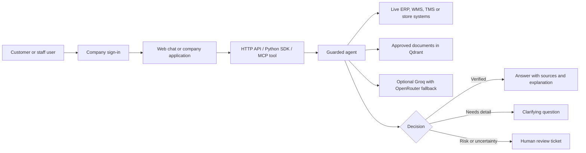

# Project overview

Customer Agent is an embeddable Python agent for two related tasks: store support and supply chain operations. The web workspace, HTTP API, and MCP tool use the same guarded decision logic as the Python SDK. It answers routine questions only when current records or approved document evidence support the answer. It asks for missing details or creates a human review ticket when an action, exception, outage, stale record, or uncertain answer needs a person.

## Main components

| Component | Purpose |
| --- | --- |
| `support_agent/sdk.py` | Embeds the agent in a trusted Python backend with company source, identity, and ticket adapters. |
| `support_agent/supply.py`, `agent.py` | Check identity, source records, timestamps, allowed states, and stop rules. |
| `support_agent/supply_http.py`, `data.py` | Read live supply or store data through an HTTPS gateway or read-only database. |
| `support_agent/knowledge.py`, `document_answer.py` | Index approved documents in Qdrant and verify exact quoted evidence. |
| `support_agent/supply_multi.py`, `supply_llm.py` | Optionally route read-only tools through Groq, with OpenRouter for transient failure. |
| `support_agent/handoff.py` | Store human review tickets in the bundled SQLite queue; the SDK can accept a company ticket sink. |
| `support_agent/web/` | Responsive chat and document management UI, including streaming delivery and decision explanations. |

The model chooses a route or evidence; application code validates the source, record freshness, tool call, and final decision. The explanation is generated from those checks and cited source IDs. It does not expose model chain of thought.

## What a company must connect

The repository contains no company records or credentials. A production integration needs a current read-only operational source, trusted customer or staff sign-in, an owned ticket workflow, and approved documents if document answers are wanted. Groq and OpenRouter keys enable multi-agent mode; Qdrant and an embedding model enable document retrieval. Test accuracy on redacted questions from the company before serving real users. Synthetic records under `tests/` are only for code checks and are not packaged.

See [SDK.md](SDK.md) for embedding, [REAL_DATA.md](REAL_DATA.md) for source contracts, and [SECURITY.md](../SECURITY.md) for the trust boundaries.
